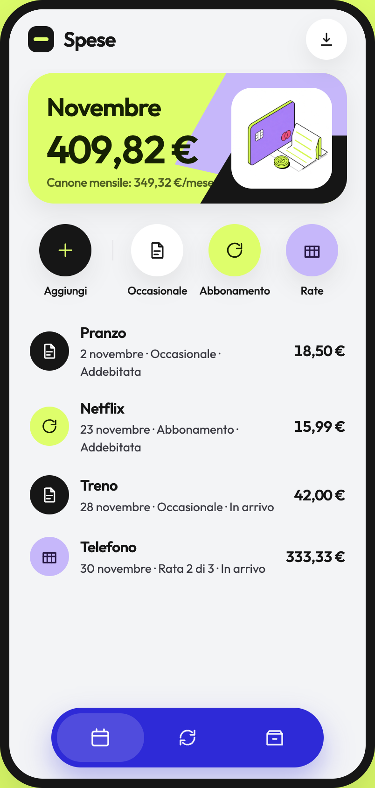
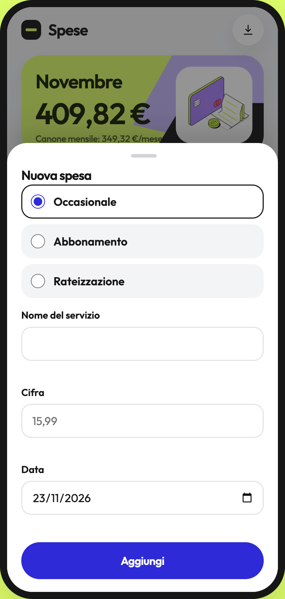
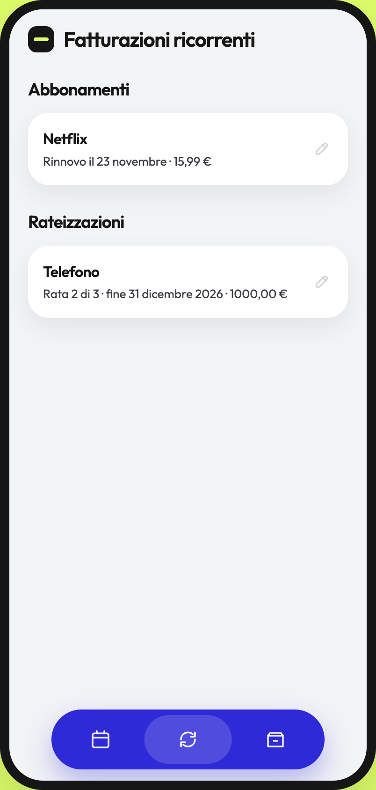
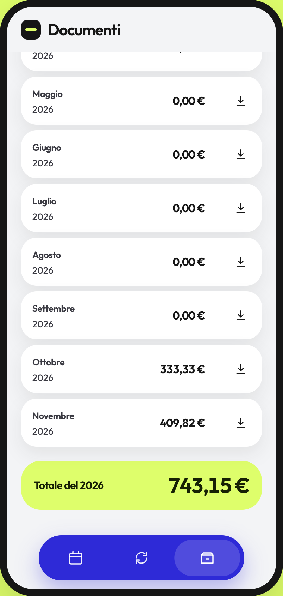
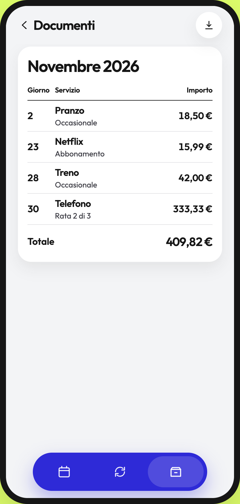

# Spese

Il conto del mese. Si aggiunge una spesa scegliendo il tipo, e il tipo decide in quali mesi entra la cifra.

[Apri l’app](https://brakoh.github.io/TrackerSpese/)

Le cifre nelle schermate sono un esempio.

## Il mese

La schermata principale è solo il mese corrente. In alto c’è il totale: somma tutto ciò che appartiene al mese, anche un rinnovo che cade più avanti. Sotto, il canone mensile raccoglie abbonamenti e rate, senza le spese di un giorno solo.

Ogni riga mostra il giorno. Così si distingue ciò che è già passato da ciò che arriva ancora. Una spesa nuova, anche se è iniziata mesi fa, compare nel mese corrente.

In basso ci sono tre sezioni: **Mese**, **Fatturazioni ricorrenti**, **Documenti**.

## Aggiungere una spesa

**Aggiungi** apre un foglio dal basso. Si sceglie il tipo, si scrive il nome del servizio e i dati di quel tipo. I nomi già usati tornano come suggerimento.

I tre tipi si distinguono da come la cifra cade sui mesi.

**Occasionale.** Nome, cifra e data. Vale per quel giorno.

**Abbonamento**, solo mensile. Nome, tariffa mensile e giorno di rinnovo. Resta attivo finché non si disdice. Un abbonamento attivo entra nel mese anche se il rinnovo è più avanti. La disdetta lascia il mese in corso e toglie il rinnovo da quello successivo. Accanto al giorno si legge anche il mese del prossimo addebito automatico.

**Rateizzazione.** Nome, data del primo addebito, costo totale e numero di mesi. Compare dal mese del primo addebito, per quel numero di mesi, con la quota: il totale diviso i mesi. L’ultima quota prende i centesimi che avanzano. Un giorno 31, in un mese più corto, cade l’ultimo giorno.

Passare da Abbonamento a Rateizzazione, e il ritorno, cambia il foglio subito. Gli altri cambi di tipo accompagnano il foglio mentre si allunga o si accorcia.

Il foglio si chiude trascinandolo verso il basso, toccando lo sfondo o con Esc. Se ci sono modifiche non salvate, chiede conferma.

## Filtrare la lista

**Occasionale**, **Abbonamento** e **Rate** non creano una spesa: filtrano il mese. Il pulsante scelto si segna con un anello e gli altri due si abbassano. Le righe di quella categoria salgono in cima, separate da una linea sottile. Un secondo tocco sullo stesso pulsante toglie il filtro.

Se nel mese non c’è nessuna spesa, i tre pulsanti restano spenti. Se la categoria scelta è vuota, sopra la lista compare una frase che lo dice. Il filtro si spegne quando si lascia la home.

Tra Aggiungi e i tre filtri c’è un trattino verticale: Aggiungi resta l’azione, gli altri tre sono un gruppo.

## Eliminare

Su una riga del mese, trascina verso sinistra. Compare il comando rosso. L’eliminazione chiede conferma e toglie la spesa da tutti i mesi in cui compare. Appena il dito va a sinistra, la lista smette di scorrere in verticale.

## Fatturazioni ricorrenti

Qui stanno gli abbonamenti attivi e le rateizzazioni attive. Ogni scheda si apre in modifica, e chiusa la modifica si torna su questa pagina.

La disdetta di un abbonamento sta nella modifica: «dal mese prossimo non si rinnova». La matita sulla scheda è il segno che la riga si può aprire.

## Documenti

L’elenco di un anno, da gennaio in alto fino al mese corrente in basso. Ogni mese ha il suo totale. In fondo c’è il totale dell’anno. La freccia scarica il PDF di quel mese.

Ogni mese, compreso quello corrente, apre un rendiconto in sola lettura: giorno, servizio, importo e totale. Anche da lì si scarica il PDF.

## Dove restano i dati

Le spese restano in questo browser, su questo dispositivo. Non c’è un account e nulla viene inviato a un server. Se cambi telefono o cancelli i dati del sito, l’elenco si svuota.

Su iPhone l’app sta a tutto schermo, in verticale. Da Safari si può aggiungere alla schermata Home.
